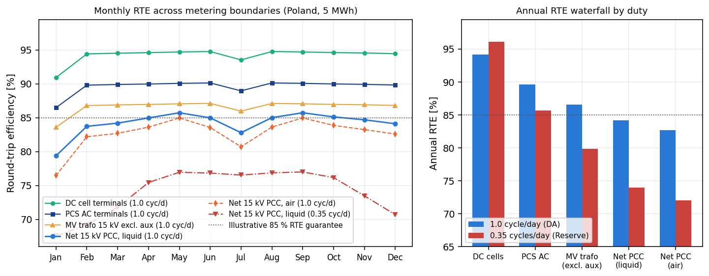
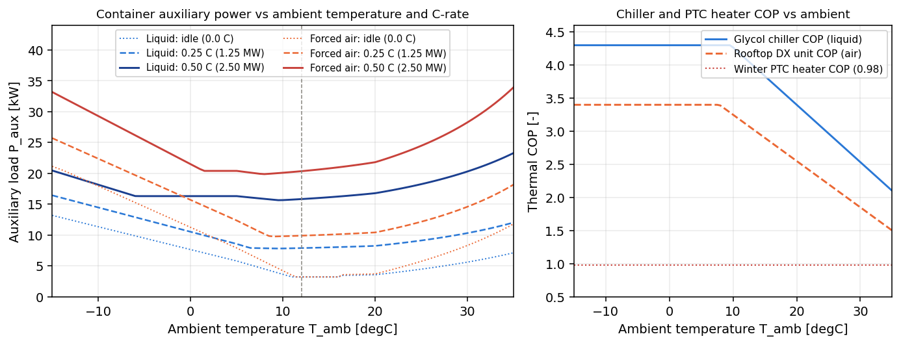
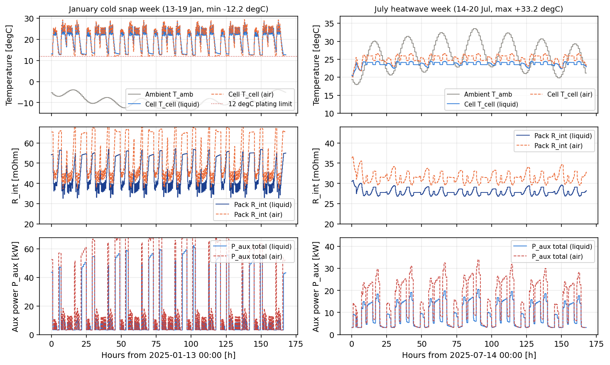
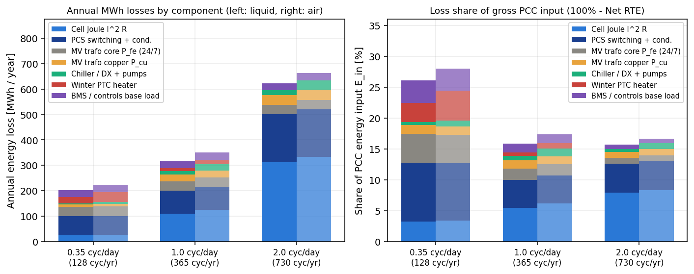

# Container thermal balance, HVAC auxiliary load and net RTE of a grid battery in Poland

[](https://github.com/kwwaleszczynski-del/bess-thermal-aux-load/actions/workflows/ci.yml)

Investment spreadsheets for utility-scale battery storage almost always treat AC-AC round-trip efficiency (RTE) as a
single constant around 88 %. Once a container is connected through a step-up transformer to a 15 kV point of common
coupling (PCC) in Central European weather, metered AC-AC efficiency is neither 88 % nor constant: it varies by
more than 6 percentage points across the calendar year and by more than 10 percentage points between day-ahead
arbitrage and low-cycling reserve duty.

This repository models the coupled electro-thermal balance, auxiliary power consumption, and power-conversion loss
chain of a 20-foot 2.5 MW / 5.0 MWh lithium iron phosphate (LFP) container over an 8,760-hour Polish meteorological
year (52.2 N, 21.0 E):

1. **Cell internal heat generation (`Q_cell`)**: irreversible Joule heating with Arrhenius temperature-dependent and
   SoC-dependent internal resistance (doubling between 25 degC and 5 degC), paired with reversible entropic heat across
   the LFP open-circuit voltage plateaus.
2. **Two-node thermal state-space (`T_cell`, `T_enc`)**: compares a **Liquid-Cooled Container** (aluminum cold plates,
   water-glycol chiller, PTC heater, insulated 115 W/K enclosure) against a **Forced-Air Container** (rooftop DX unit,
   supply/return blowers, 195 W/K enclosure) under ambient heat exchange and solar sol-air gain on the container roof.
3. **HVAC and continuous auxiliary load (`P_aux`)**: Carnot-derated chiller COP (`COP = 3.4` at 20 degC falling to
   `2.1` at 35 degC), glycol circulation pumps (`1.8 kW` when active), continuous BMS/EMS/fire-suppression controls
   (`3.2 kW` = `28.0 MWh/yr`), and winter PTC heating (`COP = 0.98`) whenever `T_cell < 12 degC` to prevent lithium
   plating during charging.
4. **PCS and 0.8/15 kV MV step-up transformer losses**: bidirectional inverter switching and conduction loss curve plus
   24/7 transformer iron core no-load loss (`P_fe = 4.2 kW` = `36.8 MWh/yr`) and quadratic copper load loss (`24.0 kW`
   at rated 2.5 MVA).
5. **First-law verification and telemetry parameter recovery**: exact electrical and thermal conservation over all
   8,760 hours (`< 1e-12 MWh` and `< 1e-8 MJ`), and breakpoint grid-search + non-negative least squares (NNLS) recovery
   of the empirical piecewise-linear auxiliary model used for operational LTSA reporting in the companion repository
   [bess-ops-warranty](https://github.com/kwwaleszczynski-del/bess-ops-warranty).

Interactive dashboard: https://kwwaleszczynski-del.github.io/bess-thermal-aux-load/

## Key results

### 1. Why a constant 88 % spreadsheet RTE fails at the 15 kV revenue meter

Across 8,760 hours in Central Poland, a 2.5 MW / 5.0 MWh container is simulated under three operating regimes:

1. **Low-cycling reserve / capacity market duty** (`0.35 cycles/day`, `128 cycles/yr`)
2. **Day-ahead 1-cycle arbitrage** (`1.0 cycle/day`, `365 cycles/yr`)
3. **Heavy 2-cycle arbitrage + intraday** (`2.0 cycles/day`, `730 cycles/yr`)

| Operating duty | Cooling architecture | DC cell RTE | PCS AC RTE (excl. aux) | MV trafo RTE (excl. aux) | Net 15 kV PCC RTE (annual) | Jan / Jul / May-Sep PCC RTE | Max cell spread | Annual aux load |
|---|---|---|---|---|---|---|---|---|
| 0.35 cyc/d (128 cyc/yr) | Liquid (cold plates) | 96.1 % | 85.7 % | 79.8 % | **73.9 %** | 67.6 % / 76.5 % / 77.0 % | 1.8 K | 56.1 MWh |
| 0.35 cyc/d (128 cyc/yr) | Forced air (rooftop DX) | 95.9 % | 85.4 % | 79.6 % | **72.0 %** | 63.6 % / 76.2 % / 76.7 % | 5.6 K | 74.2 MWh |
| 1.0 cyc/d (365 cyc/yr) | Liquid (cold plates) | **94.2 %** | **89.6 %** | **86.6 %** | **84.2 %** | **79.4 % / 82.8 % / 85.7 %** | **2.4 K** | **53.6 MWh** |
| 1.0 cyc/d (365 cyc/yr) | Forced air (rooftop DX) | 93.4 % | 88.8 % | 85.9 % | **82.7 %** | 76.5 % / 80.7 % / 85.0 % | **7.8 K** | **72.0 MWh** |
| 2.0 cyc/d (730 cyc/yr) | Liquid (cold plates) | **91.8 %** | 87.2 % | 85.4 % | **84.3 %** | 83.2 % / 83.8 % / 84.8 % | 3.1 K | 46.1 MWh |
| 2.0 cyc/d (730 cyc/yr) | Forced air (rooftop DX) | 91.3 % | 86.7 % | 84.9 % | **83.4 %** | 82.1 % / 82.8 % / 84.0 % | 9.6 K | 66.5 MWh |

- **Each metering boundary takes a distinct slice of round-trip efficiency.** At `1.0 cycle/day` (Liquid-Cooled),
  electrochemical conversion at the DC cell terminals is **94.2 %** (falling to **91.8 %** at `2.0 cycles/day` due to
  quadratic $`I^2 R`$ losses). Inverter switching and conduction losses bring AC PCS-terminal efficiency to **89.6 %**.
  Stepping up through the 0.8/15 kV transformer (36.8 MWh/yr core loss plus copper loss) reduces efficiency to
  **87.0 %** before any container auxiliaries are counted. Including HVAC, glycol pumps, and continuous BMS/EMS load
  brings net metered AC-AC RTE at the 15 kV PCC to **84.1 %** (Liquid-Cooled) and **82.6 %** (Air-Cooled).
- **Seasonal weather drives a 6.3 percentage-point monthly swing at 1.0 cycle/day.** Net PCC RTE drops to **79.4 % in
  January** (when sub-zero ambient temperatures trigger winter PTC heating and elevate cold-cell internal resistance
  $`R_{\mathrm{int}}`$), dips to **82.8 % in July** (when afternoon heatwaves up to +33.2 degC coincide with Carnot-derated
  chiller COP), and peaks at **85.7 % in May and September** when mild ambient temperatures (`14.5 degC` mean) keep the
  cells in their `20-24 degC` window with minimal active heating or compressor draw.
- **Low-cycling reserve duty collapses net metered RTE to 73.8 %.** At `0.35 cycles/day` (`128 cycles/yr`), cell
  self-heating $`I^2 R`$ is small, so the container loses heat through the walls in winter and relies on the PTC heater
  (`24.5 MWh/yr`) to keep cells above the `12 degC` lithium-plating floor. Combined with 24/7 MV transformer core loss
  (`36.8 MWh/yr`) and continuous BMS/controls draw (`28.0 MWh/yr`), standing parasitic losses total **`89.3 MWh/yr`
  (`~90 MWh/yr`)**, dragging net PCC RTE down to **73.8 %** and violating a naive 85 % monthly RTE guarantee across the
  year (11 to 12 months below 85 % unless auxiliary and transformer core losses are separated from the PCS guarantee,
  as shown in [bess-ops-warranty](https://github.com/kwwaleszczynski-del/bess-ops-warranty)).



### 2. Liquid cold-plate cooling vs forced-air rooftop DX HVAC

Comparing the two thermal architectures on the identical 5 MWh container and Polish weather record at `1.0 cycle/day`:

- **26.0 % lower annual auxiliary electricity (`18.5 MWh/yr` saved):** Liquid cooling consumes **52.7 MWh/yr** of
  total auxiliary power (`28.0 MWh` BMS/controls, `10.8 MWh` winter PTC heating, `13.9 MWh` chiller and circulating
  glycol pumps) against **71.2 MWh/yr** for the forced-air container (`28.0 MWh` BMS/controls, `17.8 MWh` PTC heating
  through higher `195 W/K` wall/louver conductance, `25.4 MWh` rooftop DX compressor and blowers).
- **3.2x tighter cell-to-cell temperature uniformity:** High heat-transfer conductance between the aluminum cold plates
  and LFP modules (`18.5 kW/K` active vs `5.4 kW/K` for ducted air) keeps maximum module-to-module temperature spread
  within **2.4 K** (Liquid-Cooled) versus **7.8 K** (Air-Cooled), preventing localized hot-spot accelerated calendar
  and cycle fade.



### 3. Winter cold snap (`-12.2 degC`) vs summer heatwave (`+33.2 degC`) dynamics

Quarter-hour resolution trajectories during a continental January cold snap (13-19 January) and a July heatwave
(14-20 July) illustrate how thermal capacitance (`C_cell = 4.8 MJ/K`, `C_enc = 0.9 MJ/K`) filters rapid ambient swings
while coupling directly into internal resistance:





### 4. First-law verification and empirical auxiliary parameter recovery

All six simulation runs satisfy exact first-law electrical and thermal conservation over the 8,760-hour horizon, and
recover the four-parameter piecewise-linear auxiliary model used in operational SCADA analytics:

| Verification check / parameter | Ground truth / criterion | Simulated / recovered value |
|---|---|---|
| Electrical balance `E_in,pcc - E_out,pcc - dE_stored == sum(losses)` | `< 1e-6 MWh` | max residual `5.68e-13 MWh` |
| Two-node thermal balance `C_cell dT_cell + C_enc dT_enc == sum(Q)` | `< 1e-6 MJ` | max residual `1.18e-9 MJ` |
| Arrhenius resistance ratio `R_int(5 degC) / R_int(25 degC)` | `2.0000` | `2.0000` |
| Liquid chiller COP at `20 degC` / `35 degC` | `3.40` / `2.10` | `3.40` / `2.10` |
| Piecewise-linear recovery: base load `b_0` | `5.00 kW` | `5.001 kW` |
| Piecewise-linear recovery: heating slope `h` below `T_h` | `0.85 kW/K` below `12.0 degC` | `0.850 kW/K` below `12.0 degC` |
| Piecewise-linear recovery: cooling slope `c` above `T_c` | `0.62 kW/K` above `18.0 degC` | `0.620 kW/K` above `18.0 degC` |
| Piecewise-linear recovery: load coefficient `k` (`R^2`) | `1.40 kW/MW` | `1.399 kW/MW` (`R^2 = 0.9999`) |

## Method

### 1. Electro-thermal LFP cell model

For pack chemical power $`P_{\mathrm{chem}}`$ (`+` discharge, `-` charge) and open-circuit pack voltage
$`U_{\mathrm{ocv}}(\mathrm{SoC})`$, the pack current is $`I = P_{\mathrm{chem}} / U_{\mathrm{ocv}}(\mathrm{SoC})`$.
Total internal heat generation $`Q_{\mathrm{cell}}`$ combines irreversible Joule dissipation and reversible entropic
heat across the LFP phase-staging plateaus:

```math
Q_{\mathrm{cell}} = Q_{\mathrm{Joule}} + Q_{\mathrm{rev}}
= I^2 R_{\mathrm{int}}(T_{\mathrm{cell}}, \mathrm{SoC})
+ I \, T_{\mathrm{cell}} \, \frac{\partial U_{\mathrm{ocv}}}{\partial T}(\mathrm{SoC})
```

where the pack internal resistance follows an Arrhenius temperature law above a quadratic/cubic SoC bowl:

```math
R_{\mathrm{int}}(T_{\mathrm{cell}}, \mathrm{SoC})
= R_{25}(\mathrm{SoC}) \, \exp\!\left[\frac{E_a}{R}\left(\frac{1}{T_{\mathrm{cell}}} - \frac{1}{298.15}\right)\right]
```

With activation temperature $`E_a / R = 2874.15\;\mathrm{K}`$, $`R_{\mathrm{int}}`$ doubles between `25 degC` (`298.15 K`)
and `5 degC` (`278.15 K`).

### 2. Two-node container thermal state-space

The LFP racks (`C_cell = 4.8 MJ/K`) and the coolant/enclosure volume (`C_enc = 0.9 MJ/K`) evolve as a coupled two-node
system integrated implicitly at 15-minute sub-steps:

```math
\begin{aligned}
C_{\mathrm{cell}} \frac{\mathrm{d}T_{\mathrm{cell}}}{\mathrm{d}t} &= Q_{\mathrm{cell}} - UA_{\mathrm{int}}\,(T_{\mathrm{cell}} - T_{\mathrm{enc}}) \\[1ex]
C_{\mathrm{enc}} \frac{\mathrm{d}T_{\mathrm{enc}}}{\mathrm{d}t} &= UA_{\mathrm{int}}\,(T_{\mathrm{cell}} - T_{\mathrm{enc}}) + \alpha\,G_{\mathrm{poa}}\,A_{\mathrm{roof}} - UA_{\mathrm{wall}}\,(T_{\mathrm{enc}} - T_{\mathrm{amb}}) - Q_{\mathrm{hvac}}
\end{aligned}
```

where $`Q_{\mathrm{hvac}} = Q_{\mathrm{cool,th}} - Q_{\mathrm{heat,th}}`$ is the net thermal power extracted by the
chiller or injected by the winter PTC heater. Summing both nodes yields the exact thermal conservation law over any
interval:

```math
C_{\mathrm{cell}}\,\Delta T_{\mathrm{cell}} + C_{\mathrm{enc}}\,\Delta T_{\mathrm{enc}}
= \int \left(Q_{\mathrm{cell}} + Q_{\mathrm{solar}} - Q_{\mathrm{wall}} - Q_{\mathrm{hvac}}\right)\mathrm{d}t
```

### 3. PCS, MV transformer, and auxiliary power chain

At every step, active power is tracked from stored chemical energy to the 15 kV point of common coupling:

```math
\begin{aligned}
P_{\mathrm{dc,term}} &= P_{\mathrm{chem}} - Q_{\mathrm{Joule}} - Q_{\mathrm{rev}} \\
P_{\mathrm{loss,pcs}} &= p_0 + k_1\,|P_{\mathrm{dc,term}}| + k_2\,P_{\mathrm{dc,term}}^2 \\
P_{\mathrm{pcs,ac}} &= P_{\mathrm{dc,term}} - P_{\mathrm{loss,pcs}} \\
P_{\mathrm{loss,trafo}} &= P_{\mathrm{fe}} + P_{\mathrm{cu,rated}}\left(\frac{P_{\mathrm{pcs,ac}}}{S_{\mathrm{rated}}}\right)^2 \\
P_{\mathrm{aux}} &= P_{\mathrm{bms}} + \frac{Q_{\mathrm{heat,th}}}{\eta_{\mathrm{ptc}}} + \frac{Q_{\mathrm{cool,th}}}{\mathrm{COP}(T_{\mathrm{amb}})} + P_{\mathrm{pump}} \\
P_{\mathrm{pcc}} &= P_{\mathrm{pcs,ac}} - P_{\mathrm{loss,trafo}} - P_{\mathrm{aux}}
\end{aligned}
```

Integrating $`P_{\mathrm{in,pcc}} = \max(-P_{\mathrm{pcc}}, 0)`$ and $`P_{\mathrm{out,pcc}} = \max(P_{\mathrm{pcc}}, 0)`$
over 8,760 hours yields the exact first-law electrical energy balance:

```math
E_{\mathrm{in,pcc}} - E_{\mathrm{out,pcc}} - \Delta E_{\mathrm{stored}}
= E_{\mathrm{Joule}} + E_{\mathrm{entropic}} + E_{\mathrm{pcs}} + E_{\mathrm{trafo,fe}} + E_{\mathrm{trafo,cu}} + E_{\mathrm{aux}}
```

## Run it

```bash
python -m venv .venv
.venv/Scripts/pip install -e ".[dev]"          # .venv/bin/pip on Linux/macOS
pytest -q                                      # 21 tests, no network
python -m bess_thermal run                     # runs 8,760-hour study, writes results/, docs/img/*.png, docs/data.js
python -m bess_thermal verify                  # prints JSON verification of first-law balances and parameter recovery
```

```
src/bess_thermal/
  config.py        2.5 MW / 5.0 MWh LFP container, cooling systems, PCS/MV transformer, and duty specs
  weather.py       deterministic 8,760-hour Central Poland weather profile (52.2 N, 21.0 E)
  duties.py        hourly chemical dispatch schedules (0.35, 1.0, and 2.0 cycles/day)
  physics.py       Arrhenius R_int(T, SoC), entropic heat, chiller COP(T_amb), PCS and transformer loss laws
  simulation.py    coupled 2-node electro-thermal solver, metering boundary RTE waterfall, conservation checks
  verification.py  first-law verification and breakpoint grid-search + NNLS auxiliary model recovery
  plots.py         matplotlib figures in docs/img/
  pipeline.py      end-to-end study runner and docs/data.js generator
  cli.py           command-line interface
tests/
  test_bess_thermal.py
```

## License

MIT.
