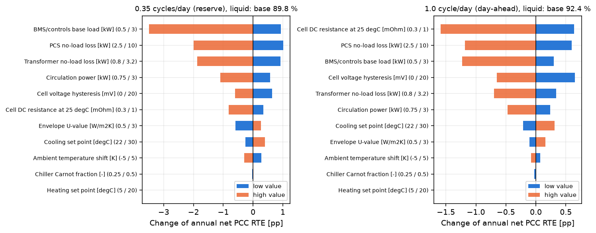

# Container thermal balance, HVAC auxiliary load and net RTE of a grid battery in Poland

[](https://github.com/kwwaleszczynski-del/bess-thermal-aux-load/actions/workflows/ci.yml)

How much of the energy a battery container buys at the grid connection comes back, where the rest goes, and how
much the weather matters. The repository models a generic 20-foot 2.5 MW / 5 MWh lithium iron phosphate (LFP)
container hour by hour (15-minute sub-steps) over one year of ERA5 weather for Central Poland (52.2 N, 21.0 E, 2025):

1. **Cell heat**: Joule heat with a temperature- and SoC-dependent resistance, a rate-independent LFP voltage
   hysteresis, and reversible (entropic) heat.
2. **Two-node thermal model** (cells, and coolant/air with racks and shell) for a **liquid-cooled** container (cold
   plates, glycol chiller) and a **forced-air** container (DX air conditioner), both with an electric heater, an
   insulated envelope and sol-air gain on the roof.
3. **Auxiliary load**: chiller electricity from a Carnot-fraction COP, heater electricity, pump or fan power, and a
   24/7 base load for BMS and controls.
4. **Power chain** from the cells through the PCS and a 0.8/15 kV transformer to the point of common coupling (PCC),
   giving the round-trip efficiency (RTE) at each metering boundary.
5. **Checks that can fail**: a plant-level energy balance, the solver against an exact solution, time-step
   convergence, a closed-form heater case, and a one-at-a-time sensitivity of every main assumption.

All inputs are stated, generic assumptions (table below), not data of a specific product, and no measured container
data are used: the model is not validated against field measurements.

<!-- headline:start -->
**Headline (liquid cooling, ERA5 2025):** net RTE at the PCC is **92.4 %** at 1 cycle/day with a peak of 0.18 C and
**89.8 %** at 0.35 cycles/day (peak 0.09 C). Cycling the same 5 MWh a day at the rated 0.5 C (2 h charge, 2 h
discharge) gives **88.2 %**, 4.2 pp less: cells +62.5 MWh/yr, transformer +18.7, auxiliaries +5.1 and PCS -1.3 (its
no-load loss runs for fewer hours).
<!-- headline:end -->

Interactive dashboard: https://kwwaleszczynski-del.github.io/bess-thermal-aux-load/

## Key results

### 1. Round-trip efficiency at each metering boundary

Four duties, each a fixed daily schedule that returns to 50 % SoC every day: three stylised ones well below the
container's rated 0.5 C, namely 0.35 cycles/day (reserve-like, 0.09 C), 1 cycle/day (day-ahead arbitrage, up to
0.18 C) and 2 cycles/day (up to 0.225 C), and 1 cycle/day at the rated 0.5 C (2 h charge at full power, two 1 h
discharges, full SoC window) to show what the low C-rates are worth. RTE at a boundary is the energy exported there
over the energy imported there in the year; auxiliaries are supplied from the MV side, so the net RTE at the PCC
includes them.

<!-- results-tables:start -->
| Duty | Cooling | DC | PCS AC | MV, excl. aux | LV net | **PCC net** | PCC net, lowest / highest month |
|---|---|---|---|---|---|---|---|
| 0.35 cycles/day (reserve) | Liquid (cold plates) | 98.5 % | 94.6 % | 92.4 % | 92.0 % | **89.8 %** | 89.0 % (Jul) / 90.4 % (Feb) |
| 0.35 cycles/day (reserve) | Forced air (DX) | 98.5 % | 94.6 % | 92.4 % | 91.8 % | **89.7 %** | 89.0 % (Jul) / 90.2 % (Feb) |
| 1.0 cycle/day (day-ahead) | Liquid (cold plates) | 97.9 % | 94.7 % | 93.6 % | 93.5 % | **92.4 %** | 92.2 % (Jul) / 92.5 % (Feb) |
| 1.0 cycle/day (day-ahead) | Forced air (DX) | 97.9 % | 94.7 % | 93.6 % | 93.3 % | **92.2 %** | 92.0 % (Jul) / 92.3 % (Feb) |
| 2.0 cycles/day (two-cycle) | Liquid (cold plates) | 97.3 % | 94.4 % | 93.4 % | 93.4 % | **92.5 %** | 92.4 % (Jul) / 92.5 % (Feb) |
| 2.0 cycles/day (two-cycle) | Forced air (DX) | 97.3 % | 94.4 % | 93.4 % | 93.2 % | **92.3 %** | 92.1 % (Jul) / 92.4 % (Feb) |
| 1.0 cycle/day at 0.5 C (rated power) | Liquid (cold plates) | 94.6 % | 91.6 % | 89.6 % | 90.2 % | **88.2 %** | 88.1 % (Jul) / 88.3 % (Jan) |
| 1.0 cycle/day at 0.5 C (rated power) | Forced air (DX) | 94.7 % | 91.7 % | 89.7 % | 89.9 % | **87.9 %** | 87.5 % (Jul) / 88.2 % (Feb) |

| Duty | Cooling | PCC import [MWh/yr] | Aux total [MWh/yr] | Base load | Pump / fans | Chiller | Heater | Chiller COP (annual) | Cell temp. min-max [degC] |
|---|---|---|---|---|---|---|---|---|---|
| 0.35 cycles/day (reserve) | Liquid (cold plates) | 683 | 18.4 | 8.8 | 7.0 | 2.6 | 0.00 | 5.93 | 23.3 - 25.0 |
| 0.35 cycles/day (reserve) | Forced air (DX) | 684 | 19.3 | 8.8 | 7.7 | 2.9 | 0.00 | 5.63 | 23.2 - 25.0 |
| 1.0 cycle/day (day-ahead) | Liquid (cold plates) | 1907 | 24.6 | 8.8 | 8.1 | 7.7 | 0.00 | 5.94 | 24.0 - 25.0 |
| 1.0 cycle/day (day-ahead) | Forced air (DX) | 1909 | 27.5 | 8.8 | 9.6 | 9.2 | 0.00 | 5.33 | 23.8 - 25.0 |
| 2.0 cycles/day (two-cycle) | Liquid (cold plates) | 3800 | 38.0 | 8.8 | 11.0 | 18.3 | 0.00 | 5.95 | 24.5 - 25.0 |
| 2.0 cycles/day (two-cycle) | Forced air (DX) | 3806 | 46.5 | 8.8 | 14.6 | 23.2 | 0.00 | 5.01 | 23.8 - 25.3 |
| 1.0 cycle/day at 0.5 C (rated power) | Liquid (cold plates) | 1954 | 29.6 | 8.8 | 3.1 | 17.7 | 0.00 | 5.87 | 22.2 - 29.7 |
| 1.0 cycle/day at 0.5 C (rated power) | Forced air (DX) | 1961 | 38.5 | 8.8 | 5.9 | 23.9 | 0.00 | 4.49 | 21.6 - 34.0 |

| Check | Criterion | Result |
|---|---|---|
| Plant energy balance, 8 runs (bookkeeping) | residual < 1e-6 MWh | max < 1e-9 MWh |
| Implicit Euler vs matrix exponential, 10 days free-floating (liquid) | cell node error < 0.1 K | cell 0.004 K, enclosure 0.031 K |
| Implicit Euler vs matrix exponential, 10 days free-floating (air) | cell node error < 0.1 K | cell 0.071 K, enclosure 0.532 K |
| Sub-step 15 vs 5 min, 1.0 cyc/d (liquid) | < 0.05 pp RTE, < 1 % aux | 0.000 pp, 0.27 % |
| Sub-step 15 vs 5 min, 1.0 cyc/d (air) | < 0.05 pp RTE, < 1 % aux | 0.000 pp, 0.01 % |
| Idle heater at -30 degC vs closed form (liquid) | relative error < 1e-3 | 0.807 vs 0.807 kW |
| Idle heater at -30 degC vs closed form (air) | relative error < 1e-3 | 0.307 vs 0.307 kW |

| Implied by the inputs (not fitted) | Value |
|---|---|
| DC round-trip efficiency at 0.5 C / 0.2 C, 25 degC | 94.6 % / 97.5 % |
| DC round-trip efficiency at 0.2 C, 12 degC | 96.4 % |
| PCS efficiency at 10 / 25 / 50 / 100 % load | 97.1 % / 98.2 % / 98.5 % / 98.4 % |
| Transformer efficiency at 25 / 50 / 100 % load | 99.6 % / 99.5 % / 99.2 % |
| Chiller COP at 35 degC ambient: liquid (coolant 18 degC) / air (air 20 degC) | 3.10 / 2.91 |
| Thermal time constant of the idle container (C_total / UA_env) | 117 h |
<!-- results-tables:end -->

- **Net RTE at the PCC is 92.4 % at 1 cycle/day and 89.8 % at 0.35 cycles/day** (liquid cooling, peaks of 0.18 and
  0.09 C). At 1 cycle/day the 145.5 MWh/yr lost between PCC import and export split into PCS conversion 59.7 MWh
  (41 %), cell losses 39.0 MWh (27 %), auxiliaries 24.6 MWh (17 %) and transformer 22.2 MWh (15 %).
- **The low C-rates of the stylised duties flatter the result.** The same 5 MWh a day at the rated 0.5 C (rows "at
  0.5 C") loses the amount given in the headline at the top: cell I^2R and transformer copper losses grow with the
  square of the current, while the PCS loses slightly less because its no-load loss runs for fewer hours. The cell
  heat at 0.5 C exceeds the 60 kW liquid cooling capacity, and the forced-air path reaches its 12 degC supply limit,
  so neither holds the 25 degC set point (cell temperatures in the second table).
- **Fixed losses decide the low-cycling case.** Transformer no-load loss (13.8 MWh/yr) and the control base load
  (8.8 MWh/yr) do not depend on throughput, so at 0.35 cycles/day they are 22.6 of the 69.4 MWh/yr lost, which is why
  net RTE is 2.5 pp lower than at 1 cycle/day although the DC efficiency is higher (98.5 % against 97.9 %).
- **Weather hardly moves the result.** Monthly net RTE at 1 cycle/day ranges from 92.2 % (July) to 92.5 % (February);
  at 0.35 cycles/day from 89.0 % (July) to 90.4 % (February). Winter is the better season: the chiller runs at its
  COP limit and pumps run less.
- **No heating is needed in any of the eight runs.** The insulated envelope (79 W/K) and the heat of cell losses,
  pumps and the 1 kW base load keep the cells between 23.2 and 25.3 degC all year in the three stylised duties, also
  through the coldest hour of 2025 (-14.4 degC, 17 February). The idle container alone would settle 12.7 K above
  ambient, with a thermal time constant of 117 h. Heating appears only with a much leakier envelope at low cycling (U = 3 W/(m2 K): 0.26 MWh/yr).
  2025 was mild (February mean -1.1 degC); a 5 K colder year still needs no heating (sensitivity table).


### 2. Liquid cold plates against forced air

On the same container and weather at 1 cycle/day, liquid cooling needs 24.6 MWh/yr of auxiliary energy against
27.5 MWh/yr for forced air (2.96 MWh/yr or 10.8 % less), and net RTE differs by 0.2 pp (92.4 % against 92.2 %). The
difference comes from the inputs, not from a factor: the lower cell-to-air conductance (2 against 12 kW/K) needs
colder air for the same heat, which lowers the evaporating temperature and the COP (annual 5.33 against 5.94), and
the fans draw more than the pump (2 against 1.5 kW). The gap grows at 2 cycles/day (46.5 against 38.0 MWh/yr).

A two-node model cannot say anything about the cell-to-cell temperature spread, which is often the stronger argument
for liquid cooling; the earlier version's spread figures are dropped.


### 3. Coldest and hottest week

Quarter-hour trajectories for the week around the coldest and the hottest hour of 2025 at 1 cycle/day. The cell
mass (29.2 MJ/K) filters the ambient swings completely; the control holds the cells at the 25 degC cooling set point.


### 4. Which assumptions matter

Each input set to a low and a high value with everything else at base (liquid cooling). Over these ranges the
electrical inputs (cell resistance and hysteresis, PCS and transformer no-load losses, base load) move net RTE by
1.0 to 4.4 pp; the thermal inputs (envelope, set points, COP, a 5 K shift of the whole year) by less than 0.9 pp.
The heating set point has no effect because the cells never get near it.

<!-- sensitivity-table:start -->
| Input (low / base / high) | 0.35 cyc/d: net PCC RTE low / high | 1.0 cyc/d: net PCC RTE low / high |
|---|---|---|
| Cell DC resistance at 25 degC [mOhm] (0.3 / 0.5 / 1) | 90.2 % / 89.0 % | 93.0 % / 90.8 % |
| PCS no-load loss [kW] (2.5 / 5 / 10) | 90.9 % / 87.8 % | 93.0 % / 91.2 % |
| BMS/controls base load [kW] (0.5 / 1 / 3) | 90.8 % / 86.4 % | 92.7 % / 91.1 % |
| Cell voltage hysteresis [mV] (0 / 10 / 20) | 90.5 % / 89.2 % | 93.0 % / 91.7 % |
| Transformer no-load loss [kW] (0.8 / 1.575 / 3.2) | 90.8 % / 88.0 % | 92.7 % / 91.7 % |
| Circulation power [kW] (0.75 / 1.5 / 3) | 90.4 % / 88.7 % | 92.6 % / 91.9 % |
| Cooling set point [degC] (22 / 25 / 30) | 89.6 % / 90.2 % | 92.2 % / 92.7 % |
| Envelope U-value [W/m2K] (0.5 / 1 / 3) | 89.2 % / 90.1 % | 92.3 % / 92.5 % |
| Ambient temperature shift [K] (-5 / 0 / 5) | 90.1 % / 89.5 % | 92.4 % / 92.3 % |
| Chiller Carnot fraction [-] (0.25 / 0.38 / 0.5) | 89.8 % / 89.8 % | 92.3 % / 92.4 % |
| Heating set point [degC] (5 / 12 / 20) | 89.8 % / 89.8 % | 92.4 % / 92.4 % |
<!-- sensitivity-table:end -->



### 5. Context

The modelled net RTE is higher than fleet averages reported from operation, for example 82 % average monthly RTE of
the US utility-scale battery fleet in 2019 (EIA, *Utility-scale batteries and pumped storage return about 80 % of the
electricity they store*, 12 February 2021; to be verified for current fleets). The model leaves out much of what lowers
metered RTE in practice: idle days and partial-power operation (frequency response), SoC recalibration cycles,
balancing, PCS skid cooling and standby, an auxiliary transformer, cabling, reactive power and cell ageing. Read the
numbers as the efficiency of a clean, new container on a regular schedule, and those of the stylised duties as
low-C-rate cases (compare the rows at 0.5 C).

## Inputs

<!-- parameter-table:start -->
| Input | Value | Basis |
|---|---|---|
| Rated power / energy | 2.5 MW / 5 MWh | generic 20-ft LFP container |
| Pack layout | 416s x 12p, 314 Ah LFP cells | assumption (common 1,331 V nominal string) |
| Effective cell DC resistance at 25 degC | 0.5 mOhm | assumption: ohmic + polarisation; implied DC RTE in the checks table |
| Resistance vs temperature | doubles from 25 to 5 degC | Arrhenius, E_a/R = 2874 K (assumption) |
| Cell voltage hysteresis (half gap) | 10 mV | assumption, LFP charge/discharge OCV gap; to be verified per cell |
| Entropic coefficient | order 0.1 mV/K, sign changes with SoC | assumed shape, order of published LFP values; to be verified |
| Cell thermal mass | 29.2 MJ/K | 180 Wh/kg, c_p 1050 J/(kg K) (assumption) |
| Enclosure node thermal mass | 4 MJ/K | racks, coolant or air, steel shell (assumption) |
| Envelope UA | 79 W/K | 78.7 m2 (20-ft HC) x U 1 W/(m2 K) (assumption) |
| Roof solar gain | sol-air on the roof only | absorptance 0.35, h_out 20 W/(m2 K) (assumption) |
| Cell temperature band | 12 to 25 degC | heat below, cool above (assumption) |
| Heater | 15 kW, efficiency 1 | resistive, inside the envelope |
| BMS / controls base load | 1 kW, 24/7 | assumption; dissipated inside the container |
| Cell-to-coolant / cell-to-air UA | 12 / 2 kW/K | assumption (~2.4 / ~0.4 W/K per cell) |
| Evaporator approach (liquid / air) | 6 / 10 K | assumption |
| Minimum supply temperature (liquid / air) | 15 / 12 degC | assumption |
| Cooling capacity (liquid / air) | 60 / 50 kW | assumption |
| Pump / fan power while running (liquid / air) | 1.5 / 2 kW | assumption; runs while cycling or heating/cooling |
| Chiller COP model | 0.38 x Carnot, condensing at T_amb + 12 K, max 6 | assumption; no free-cooling economiser |
| PCS loss | 5 kW + 0.008 |P| + 2.4e-06 P^2 (kW) | assumption, typical central-inverter curve; sleep when idle |
| MV transformer 2.5 MVA losses | no-load 1.575 kW, load 18.5 kW | EU Ecodesign Tier 2 maximum (Reg. (EU) 548/2014, Annex I, Table I.1); to be verified |
<!-- parameter-table:end -->

Values marked as assumptions are engineering estimates for a generic container. The transformer losses are the
maximum values of Table I.1 in Commission Regulation (EU) No 548/2014 (Tier 2, from 1 July 2021) for a 2,500 kVA
liquid-immersed transformer; whether the regulation applies to a given battery transformer, and the current
consolidated text, are to be verified.

## Method

### 1. Cell heat

For chemical power $`P_{\mathrm{chem}}`$ (positive on discharge) the pack current is
$`I = P_{\mathrm{chem}} / U_{\mathrm{ocv}}(\mathrm{SoC})`$. With $`n_s`$ cells in series, hysteresis
$`U_h`$ per cell and entropic coefficient $`\partial U_{\mathrm{ocv}} / \partial T`$ per cell (Bernardi form):

```math
Q_{\mathrm{irr}} = I^2 R_{\mathrm{int}}(T_{\mathrm{cell}}, \mathrm{SoC}) + |I|\, n_s U_h,
\qquad
Q_{\mathrm{rev}} = -I\, T_{\mathrm{cell}}\, n_s \frac{\partial U_{\mathrm{ocv}}}{\partial T}(\mathrm{SoC})
```

```math
R_{\mathrm{int}} = R_{25}\, f(\mathrm{SoC}) \exp\left[\frac{E_a}{R}\left(\frac{1}{T_{\mathrm{cell}}} - \frac{1}{298.15\,\mathrm{K}}\right)\right] \frac{n_s}{n_p},
\qquad f(0.5) = 1
```

The reversible heat changes the cells' temperature but not the electrical energy; over a charge-neutral day it
nearly cancels.

### 2. Two-node thermal model

```math
\begin{aligned}
C_{\mathrm{cell}} \frac{\mathrm{d}T_{\mathrm{cell}}}{\mathrm{d}t} &= Q_{\mathrm{irr}} + Q_{\mathrm{rev}} - UA_{\mathrm{int}}\,(T_{\mathrm{cell}} - T_{\mathrm{enc}}) \\
C_{\mathrm{enc}} \frac{\mathrm{d}T_{\mathrm{enc}}}{\mathrm{d}t} &= UA_{\mathrm{int}}\,(T_{\mathrm{cell}} - T_{\mathrm{enc}}) - UA_{\mathrm{env}}\,(T_{\mathrm{enc}} - T_{\mathrm{amb}}) + Q_{\mathrm{sol}} + P_{\mathrm{base}} + P_{\mathrm{circ}} + Q_{\mathrm{heat}} - Q_{\mathrm{cool}}
\end{aligned}
```

with the roof sol-air gain $`Q_{\mathrm{sol}} = UA_{\mathrm{roof}}\, \alpha\, G / h_{\mathrm{out}}`$ ($`G`$ = ERA5
global horizontal irradiance). The system is integrated with implicit Euler at 15-minute sub-steps. When a
free-floating step would take $`T_{\mathrm{cell}}`$ below the heating or above the cooling set point, the heater or
chiller adds or removes exactly the heat that returns it to the band edge, limited by its capacity and by the
coolant/air supply temperature limits. Pumps or fans run while the battery cycles or the HVAC is active; their power
and the base load end up as heat inside the container.

### 3. Chiller and heater

```math
\mathrm{COP} = \min\left(\mathrm{COP}_{\max},\; \eta_C \frac{T_{\mathrm{evap}}}{T_{\mathrm{cond}} - T_{\mathrm{evap}}}\right),
\qquad T_{\mathrm{evap}} = T_{\mathrm{enc}} - \Delta T_{\mathrm{evap}},
\qquad T_{\mathrm{cond}} = T_{\mathrm{amb}} + \Delta T_{\mathrm{cond}}
```

$`P_{\mathrm{chiller}} = Q_{\mathrm{cool}} / \mathrm{COP}`$ and $`P_{\mathrm{heater}} = Q_{\mathrm{heat}} / \eta_h`$,
with the same heat flows that enter the thermal model.

### 4. Power chain and RTE

```math
\begin{aligned}
P_{\mathrm{dc}} &= P_{\mathrm{chem}} - Q_{\mathrm{irr}} \\
P_{\mathrm{ac}} &= P_{\mathrm{dc}} - \left(p_0 + k_1 |P_{\mathrm{dc}}| + k_2 P_{\mathrm{dc}}^2\right) \\
P_{\mathrm{mv}} &= P_{\mathrm{ac}} - P_0 - P_k \left(P_{\mathrm{ac}} / S_r\right)^2 \\
P_{\mathrm{aux}} &= P_{\mathrm{base}} + P_{\mathrm{circ}} + P_{\mathrm{heater}} + P_{\mathrm{chiller}} \\
P_{\mathrm{pcc}} &= P_{\mathrm{mv}} - P_{\mathrm{aux}}
\end{aligned}
```

Import and export are summed per sub-step at each boundary (DC, PCS AC, MV without auxiliaries, LV side with
auxiliaries, PCC); RTE is export over import. Every day is charge-neutral, so no SoC correction is needed.

### 5. Plant energy balance

Over the plant boundary, the net import at the PCC has to equal the change of stored chemical and entropic energy,
the change of sensible heat in both nodes, the heat leaving through the envelope (less the solar gain), the heat
rejected by the chiller condenser, and the PCS and transformer losses:

```math
E_{\mathrm{in,pcc}} - E_{\mathrm{out,pcc}} = \Delta E_{\mathrm{chem}} - \sum Q_{\mathrm{rev}} \Delta t + \Delta H_{\mathrm{sens}}
+ \sum (Q_{\mathrm{env}} - Q_{\mathrm{sol}}) \Delta t + \sum (Q_{\mathrm{cool}} + P_{\mathrm{chiller}}) \Delta t
+ \sum (P_{\mathrm{heater}} - Q_{\mathrm{heat}}) \Delta t + E_{\mathrm{pcs}} + E_{\mathrm{trafo}}
```

Joule heat, heater heat, pump and base-load power do not appear on the right: they have to reappear as stored heat
or as heat leaving the container. The check is bookkeeping, not validation; it fails whenever an electrical term and
the heat it produces are computed inconsistently.

### 6. Other checks

- **Solver against the exact solution**: a free-floating, idle container from unequal start temperatures, compared
  over 10 days with the matrix-exponential solution of the linear two-node system.
- **Time-step convergence**: the whole year at 15-minute and 5-minute sub-steps.
- **Closed-form heater case**: an idle container at a constant -30 degC must need
  $`P_{\mathrm{heater}} = (UA_{\mathrm{env}} (T_{\mathrm{heat}} - T_{\mathrm{amb}}) - P_{\mathrm{base}} - P_{\mathrm{circ}}) / \eta_h`$.
- **Auxiliary surrogate**: the four-parameter model used in
  [bess-ops-warranty](https://github.com/kwwaleszczynski-del/bess-ops-warranty),
  $`P_{\mathrm{aux}} = b_0 + h \max(T_h - T, 0) + c \max(T - T_c, 0) + k |P_{\mathrm{pcs}}|`$, fitted to this
  model's output at 1 cycle/day reaches R2 0.69 on hourly values (liquid and air) and 0.97 / 0.94 on daily means: it
  captures daily totals, not the hour-to-hour switching of pumps and chiller. With the same schedule every day, the
  base load and the load coefficient cannot be separated on daily data, so only the fit quality is reported. A
  separate test checks that the estimator recovers known parameters from synthetic data; that tests the fitting code
  only.

## Data

| Source | Content | Licence |
|---|---|---|
| [ERA5](https://cds.climate.copernicus.eu/) via the [Open-Meteo](https://open-meteo.com/) archive API | hourly 2 m temperature and global horizontal irradiance, 52.2 N 21.0 E, 2025, stored in CET (UTC+1) in `data/era5_central_poland_2025.csv` | CC BY 4.0 |

The download is one Open-Meteo request (2 variables, one year); `python -m bess_thermal fetch` repeats it. Contains
modified Copernicus Climate Change Service information (2025). Hersbach, H. et al. (2020), The ERA5 global
reanalysis, *Q. J. R. Meteorol. Soc.* 146, 1999-2049.

## Limitations

- Generic inputs, no product datasheets and no measured data; results show how the losses combine, not the
  performance of a specific container.
- Two nodes: no cell-to-cell temperature spread, no hot spots, no separate PCS or transformer thermal model.
- One mild weather year at one ERA5 grid point; sol-air gain on the roof only.
- Idealised control (exact hold at the band edge, no hysteresis or compressor cycling) and no free-cooling
  economiser; the COP cap stands in for it.
- Fixed daily schedules on the chemical side, no idle days, no ageing, auxiliaries supplied at MV without an
  auxiliary transformer, transformer losses at unity power factor.
- C-rate defined on the chemical side (|P_chem| / E_rated) with no power limit: at 0.5 C the PCS and the transformer
  carry slightly more than their 2.5 MW / 2.5 MVA rating while charging.

## Run it

```bash
python -m venv .venv
.venv/Scripts/pip install -e ".[dev]"          # .venv/bin/pip on Linux/macOS
pytest -q                                      # offline; includes a full rerun compared with results/ and README
python -m bess_thermal run                     # ~1.5 min: results/, docs/img/*.png, docs/data.js, README tables
python -m bess_thermal verify                  # same run, prints the checks as JSON
python -m bess_thermal fetch                   # re-download the ERA5 year (network)
```

```
data/era5_central_poland_2025.csv   hourly ERA5 weather (CET)
src/bess_thermal/
  config.py        container, cooling, chiller, PCS/transformer and duty inputs
  weather.py       ERA5 download (Open-Meteo) and loader
  duties.py        hourly charge/discharge schedules (0.35, 1 and 2 cycles/day; 1 cycle/day at 0.5 C)
  physics.py       resistance, OCV, entropic heat, chiller COP, PCS and transformer losses
  simulation.py    two-node solver with HVAC control, power chain, RTE, plant energy balance
  verification.py  checks and the auxiliary surrogate
  sensitivity.py   one-at-a-time sensitivity
  plots.py         figures in docs/img/
  pipeline.py      end-to-end run, docs/data.js, generated README tables
  cli.py           command-line interface
tests/
  test_bess_thermal.py
```

## License

MIT.

## Changes

- **30 October 2026.** An earlier version reported numbers partly set by factors tuned to target values (month- and
  duty-specific multipliers on resistance, heater and chiller electricity, PCS and transformer losses, and a cell
  temperature-spread series rescaled to fixed maxima) and ran on a synthetic weather year. Those factors are gone:
  every number comes from the single parameter set in [Inputs](#inputs) and real ERA5 weather. The headline net RTE
  changed from 84.2 % to 92.4 % (1 cycle/day, liquid) and from 73.9 % to 89.8 % (0.35 cycles/day); the large winter
  penalty and the cell-spread comparison do not survive.
- **31 October 2026.** Added a 1 cycle/day duty at the rated 0.5 C; the three stylised duties peak at 0.09 to
  0.225 C, which flatters RTE. The headline now states the peak C-rate of each number.
